  

  
  
  
  

---

### About

Third-year Computer Science student at **Sri Mittapalli College of Engineering, Guntur**, focused on **cybersecurity and ethical hacking**, with full-stack web development on the side.

- **Now:** Offensive security training on Hackversity, with 100+ labs completed and a top-3 leaderboard finish
- **Next:** Live CyberSecurity Expert internship, starting December 2026

### Tech stack

  
  
  
  
  
  
  
  

  
  
  
  
  

### Featured project

**College Event Management System** · Flask · SQLite
Role-based access for admins and students, with salted password hashing.
[View the code →](YOUR_REPO_LINK)

### Certifications

- TryHackMe: Offensive Security Intro
- HackerRank: Python (Basic) and SQL (Basic)
- NPTEL: Design & Implementation of Human-Computer Interfaces, IIT Guwahati (Elite)
- NPTEL: Social Network Analysis, IIT Madras
