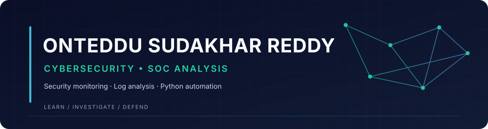

  
  
  

## About

I’m a final-year Computer Science student building practical skills for a career in **Security Operations (SOC)**. My interests include security monitoring, authentication-log analysis, incident investigation, Linux, networking, and Python-based security automation.

I focus on learning by building small defensive tools, analyzing evidence, documenting findings, and improving detection logic.

## Featured projects

<table>
  <tr>
    <td width="50%" valign="top">
      <h3><a href="https://github.com/Sudhakar-reddy20/threatlens">ThreatLens</a></h3>
      
<strong>Python · Linux logs · Detection engineering</strong>

      
A command-line SOC log analysis tool that parses SSH authentication events, detects repeated failed logins and suspicious success-after-failure patterns, and produces JSON/CSV reports with supporting evidence.

      
<a href="https://github.com/Sudhakar-reddy20/threatlens">View repository →</a>

    </td>
    <td width="50%" valign="top">
      <h3><a href="https://github.com/Sudhakar-reddy20/threatlens/tree/main/projects/windows-event-log-analyzer">Windows Event Log Analyzer</a></h3>
      
<strong>Python · Windows Security Events · XML</strong>

      
A defensive analysis tool for exported Windows Security Event XML. It reviews authentication activity and flags selected account, group-membership, and audit-log events for investigation.

      
<a href="https://github.com/Sudhakar-reddy20/threatlens/tree/main/projects/windows-event-log-analyzer">View project →</a>

    </td>
  </tr>
</table>

## Technical skills

| Area | Tools and technologies |
|---|---|
| Programming | Python, Bash |
| Operating systems | Linux, Kali Linux, Windows, macOS |
| Networking & analysis | TCP/IP fundamentals, Wireshark, Nmap |
| Security platforms | Splunk, Wazuh — learning and hands-on practice |
| Development workflow | Git, GitHub, command-line tools |

## Current learning focus

- SOC workflows, alert triage, and incident investigation
- Authentication logs and Windows Security event analysis
- Network fundamentals and packet analysis
- Python scripting for security automation

## How I approach security

- **Evidence first:** validate alerts using logs and supporting context.
- **Clear documentation:** record findings, timestamps, indicators, and next steps.
- **Responsible practice:** perform security testing only in authorized environments.

## Connect

I’m open to connecting with SOC analysts, security engineers, mentors, and teams working in defensive security.

- **LinkedIn:** [linkedin.com/in/sudhakar-reddy1920](https://www.linkedin.com/in/sudhakar-reddy1920)
- **GitHub:** [github.com/Sudhakar-reddy20](https://github.com/Sudhakar-reddy20)

  Learn continuously. Investigate carefully. Defend responsibly.

